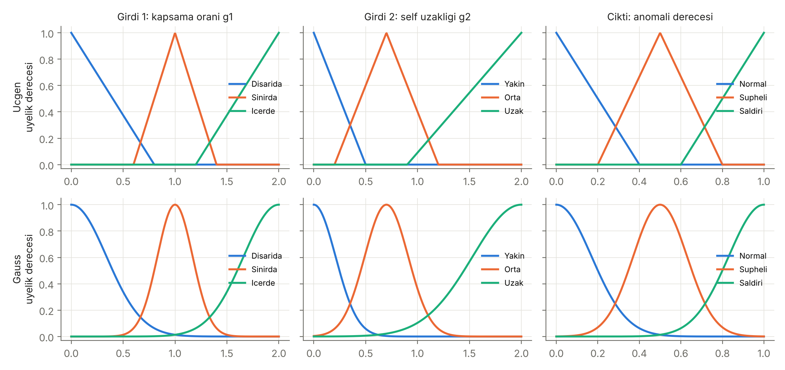
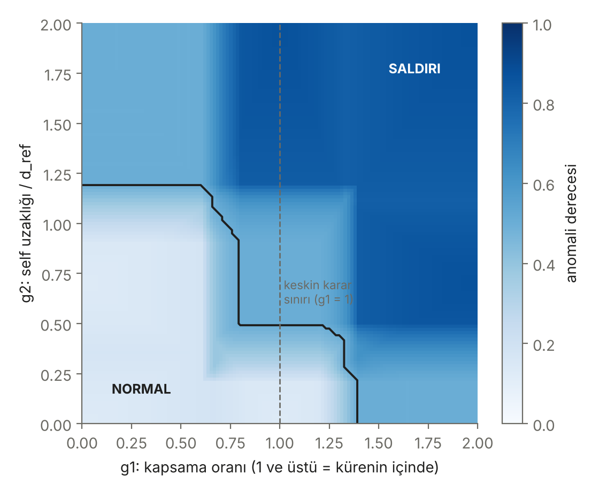
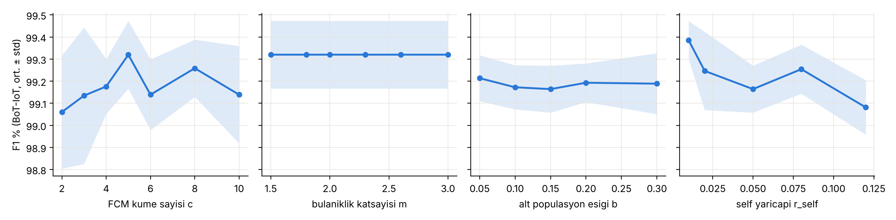
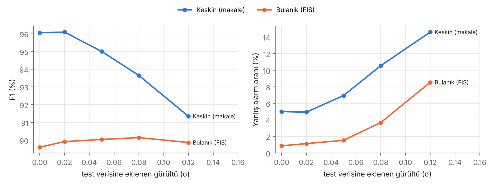

# Fuzzy-Immune IDS: NaIM-IDS Yeniden Gerçekleştirme ve Bulanık Tespit Katmanı

Bulanık Mantık dersi dönem projesi. Referans makaledeki yapay bağışıklık tabanlı IoT saldırı tespit çerçevesinin (NaIM-IDS) tespit çekirdeği yeniden gerçekleştirildi. Ardından negatif seçim dedektörlerinin üzerine Mamdani/Sugeno tabanlı bir bulanık karar katmanı eklendi.

## Student Information

- Öğrenci: Alperen Başkaya
- Öğrenci no: 1306220066
- Ders: Bulanık Mantık, 2026 Güz

## Original Paper

M. Ma, G. Yang, J. He, and W. Fang, "An adaptive detection framework based on artificial immune for IoT intrusion detection system," *Applied Soft Computing*, vol. 166, Art. no. 112152, 2024, doi: [10.1016/j.asoc.2024.112152](https://doi.org/10.1016/j.asoc.2024.112152).

Makalenin yazarları kod yayımlamamıştır. Bu repodaki kodun tamamı makaledeki tanımlardan sıfırdan yazılmıştır ve dış kaynaktan kod alınmamıştır. Makalenin vermediği ayrıntılar için yapılan varsayımlar [`docs/ASSUMPTIONS.md`](docs/ASSUMPTIONS.md) dosyasında listelenir.

## Problem Description

IoT cihazları sınırlı kaynaklarla çalışır ve sürekli yeni saldırı türleriyle karşılaşır. İmza tabanlı sistemler daha önce görülmemiş saldırıları yakalayamaz. Derin öğrenme modelleri ise ağır olabilir ve verdikleri kararı açıklamak zordur.

Yapay bağışıklık sistemlerindeki **negatif seçim algoritması (NSA)** yalnızca normal trafikten ("self") öğrenir. Normal bölgeye değmeyen dedektörler üretir ve bu dedektörlere düşen her şeyi anomali sayar. Klasik NSA'nın iki sorunu vardır: rastgele üretilen dedektörler boşluklar bırakır ve her aday dedektörün tüm self örneklerle karşılaştırılması pahalıdır.

Referans makale bu iki soruna FCM ile self kümeleme ve optimizasyonla dedektör üretimi önerir. Ancak tespit kararı **keskin** kalır: bir örnek ya bir dedektörün içindedir ya da değildir. Bu proje, bu kararı bulanık bir anomali derecesine dönüştürmenin etkisini inceler.

## Method

Yeniden gerçekleştirilen kısım (MRR), NaIM-IDS'in tespit çekirdeğidir:

1. **FCM ile self kümeleme** (makale Bölüm 3.2, Denk. 15–19): Normal örnekler Fuzzy C-Means ile kümelenir. Küme sayısı c, Com/Sep indeksiyle seçilir; m = 2.3. Aday dedektörün en yakın self uzaklığı hesaplanırken uzak kümeler üçgen eşitsizliğiyle atlanır.
2. **Sınır dedektörleri** (Bölüm 3.3.1, Algoritma 1): Self'e en yakın saldırı bölgesinde dedektör merkezi Red Fox Optimization ile aranır. Yarıçap r = d_min(c, self) − r_self olarak alınır.
3. **Sınır dışı dedektörler** (Bölüm 3.3.2, Denk. 20): Kalan saldırılar fark eşiği b'ye göre alt popülasyonlara bölünür ve her biri genetik algoritmayla (rulet seçimi, uniform çaprazlama, fast mutation) kapsanır.
4. **Baseline:** V-Detector [Ji & Dasgupta, 2004].

Kapsam dışı: RFO–HHO hibrit özellik seçimi (Bölüm 3.1) ve CEC2017 deneyleri. Gerekçe için bkz. ASSUMPTIONS A10.

## Fuzzy System Architecture

```
               +--------------------+
 x (akis) ---->| NaIM dedektorleri  |--> g1 = max_i r_i / ||x - c_i||    (kapsama orani, 0-2)
          |    +--------------------+
          |    +--------------------+
          +--->| FCM'li self uzayi  |--> g2 = d_min(x, self) / d_ref    (self uzakligi, 0-2)
               +--------------------+
                          |
                          v
   bulaniklastirma -> 9 kural (VE = min) -> Mamdani (min kirpma, max birlesim) -> durulastirma
                                         -> veya 0. derece Sugeno (agirlikli ortalama)
                          |
                          v
                 anomali derecesi [0, 1]  ->  esik  ->  NORMAL / SALDIRI
```

| Değişken | Evren | Dilsel terimler |
|---|---|---|
| g1, kapsama oranı | [0, 2]; 1 = dedektör sınırı | Dışarıda, Sınırda, İçeride |
| g2, self uzaklığı | [0, 2]; 1 = tipik saldırı uzaklığı (d_ref, eğitim saldırılarının medyanı) | Yakın, Orta, Uzak |
| Çıktı, anomali derecesi | [0, 1] | Normal, Şüpheli, Saldırı |

Kural tabanı:

| g1 \ g2 | Yakın | Orta | Uzak |
|---|---|---|---|
| **Dışarıda** | Normal | Normal | Şüpheli |
| **Sınırda** | Normal | Şüpheli | Saldırı |
| **İçeride** | Şüpheli | Saldırı | Saldırı |

- **Üyelik fonksiyonları:** üçgen ve Gauss. Gauss parametreleri, üçgenle aynı noktalarda yaklaşık 0.5 üyelik verecek şekilde seçildi.
- **Durulaştırma:** centroid, bisector, MOM. Sugeno'da sabitler Normal 0, Şüpheli 0.5, Saldırı 1.
- **Kod:** [`src/fuzzy_detect.py`](src/fuzzy_detect.py). Kütüphane kullanılmadan elle yazıldı.




## Dataset

| Veri seti | Kullanım | Boyut |
|---|---|---|
| Iris | E1, E4 (makale Tablo 7) | 150 örnek, 4 özellik; her sınıf sırayla self |
| Skin Segmentation (UCI) | E2, E4 (makale Tablo 8) | 245.057 piksel, 3 özellik; deri = self |
| BoT-IoT %5 alt küme (UNSW) | E3, E4 (makale Tablo 5) | 477 normal + 5.050 saldırı; makale özellikleri (6) ve temiz özellikler (9) |

İndirme: `python -m src.download_data`. Kaynaklar ve hazırlama adımları: [`data/README.md`](data/README.md). Ham veriler `.gitignore` ile repo dışında tutulur.

## Project Structure

```
demo.py            canli demo (girdi degerleri veya veri setinden ornekle)
src/
  data.py          veri yukleme ve on isleme
  fcm.py           Fuzzy C-Means (Denk. 15-19), Com/Sep indeksi
  detectors.py     FCM budamali self uzayi ve dedektor kumesi
  vdetector.py     V-Detector baseline
  rfo.py           Red Fox Optimization
  ga.py            ikili kodlu genetik algoritma
  naim.py          NaIM-IDS dedektor uretimi
  fuzzy_detect.py  bulanik tespit katmani (MF, Mamdani, Sugeno, durulastirma)
  metrics.py       DR, FAR, accuracy, precision, F1
experiments/baseline/   E1 Iris, E2/E3 Skin + BoT-IoT, E6 ablasyon, E8 hassasiyet
experiments/proposed/   E4/E5 bulanik katman, E7 gurultu, sure olcumu, grafikler
results/tables/, results/figures/
docs/ASSUMPTIONS.md     yeniden gerceklestirme varsayimlari
references/README.md    kaynakca ve literatur karsilastirmasi
```

## Installation

```bash
git clone https://github.com/alperenbaskaya/fuzzy-logic-project.git
cd fuzzy-logic-project
python -m venv .venv
source .venv/bin/activate          # Windows: .venv\Scripts\activate
pip install -r requirements.txt
```

## Requirements

Python 3.10 veya üzeri. Test edilen sürümler: Python 3.13, numpy 2.5, scipy 1.18, scikit-learn 1.9, pandas 3.0, matplotlib 3.11, tabulate 0.10. Liste: [`requirements.txt`](requirements.txt).

## How to Run

```bash
# 0) veri setlerini indir (~68 MB indirme, acilinca ~1 GB; Iris icin gerekmez)
python -m src.download_data

# canli demo
python demo.py --g1 1.1 --g2 0.4 --plot
python demo.py --g1 1.1 --g2 0.4 --mf gauss --inference sugeno
python demo.py --data botiot --n 4

# yeniden uretim deneyleri (baseline)
python -m experiments.baseline.run_iris            # E1, ~1 dk
python -m experiments.baseline.run_skin_botiot     # E2, E3, E6, ~2 dk
python -m experiments.baseline.run_sensitivity     # E8, ~4 dk

# onerilen yontem
python -m experiments.proposed.run_fuzzy_iris      # E4/E5/E7 Iris
python -m experiments.proposed.run_fuzzy           # E4/E5/E7 Skin + BoT-IoT, ~1.5 dk
python -m experiments.proposed.run_timing          # calisma suresi
python -m experiments.proposed.plot_figures        # grafikler
```

Tüm deneyler sabit tohumlarla çalışır; aynı ortamda tekrar çalıştırıldığında tablolar birebir aynı çıkar. Yalnızca süre sütunları değişir.

## Reproduction Experiments

### E1 — Iris (makale Tablo 7)

20 tekrar. Test tüm veri üzerinde yapıldı. Tam tablo: [`results/tables/e1_iris_vs_paper.md`](results/tables/e1_iris_vs_paper.md).

| Self (eğitim) | Algoritma | DR % (bizim / makale) | FAR % (bizim / makale) |
|---|---|---|---|
| Versicolor (%50) | V-Detector | 94.5 / 96.5 | 10.8 / 8.6 |
| Versicolor (%50) | NaIM-IDS | 95.8 / 99.5 | 4.5 / 3.3 |
| Virginica (%50) | V-Detector | 97.8 / 96.4 | 17.9 / 10.0 |
| Virginica (%50) | NaIM-IDS | 96.7 / 99.6 | 4.5 / 7.8 |
| Versicolor (%100) | NaIM-IDS | 99.2 / 100.0 | 0.0 / 0.0 |

NaIM-IDS, V-Detector'a göre yanlış alarm oranını 2–4 kat düşürür; bu, makaledeki ana örüntüyle uyumludur. Tespit oranımız 1–4 puan düşüktür, çünkü self küresinin (r_self) içinde kalan saldırılar yakalanamaz. Dedektör sayımız makalenin çok altındadır (ör. 5.7 / 260.3); dedektörlerimiz en büyük geçerli yarıçapla üretildiği için az sayıda büyük küre yeterli olur.

### E2 — Skin ve E3 — BoT-IoT (makale Tablo 8 ve 5)

10 tekrar. Tam tablo: [`results/tables/e2_e3_e6.md`](results/tables/e2_e3_e6.md).

| Veri | Algoritma | DR % (bizim / makale) | FAR % (bizim / makale) | Dedektör sayısı (bizim / makale) |
|---|---|---|---|---|
| Skin | V-Detector | 98.60 / 87.20 | 0.03 / 3.04 | 97 / 376 |
| Skin | NaIM-IDS | 98.62 / 98.55 | 0.01 / 3.01 | 21 / 248 |

| Veri | Algoritma | Accuracy % | Recall % | Precision % | F1 % |
|---|---|---|---|---|---|
| BoT-IoT (makale) | NaIM-IDS | 98.60 | 97.73 | 99.24 | 98.47 |
| BoT-IoT, makale özellikleri | NaIM-IDS (bizim) | 98.40 | 98.28 | 99.96 | 99.12 |
| BoT-IoT, makale özellikleri | V-Detector | 92.23 | 91.53 | 99.96 | 95.36 |
| BoT-IoT, temiz özellikler | NaIM-IDS (bizim) | 98.40 | 98.36 | 99.90 | 99.12 |
| BoT-IoT, temiz özellikler | V-Detector | 77.15 | 75.29 | 99.88 | 84.85 |

- NaIM-IDS'in Skin tespit oranı ve BoT-IoT doğruluğu makaleyle 0.2 puan içinde örtüşür.
- Makalenin seçtiği özellikler (`stime`, `sport`, `seq` gibi zaman damgası ve port alanları) sızıntı riski taşır. Bu özellikler çıkarıldığında NaIM'in sonucu değişmez; yüksek doğruluk sızıntıdan gelmemektedir.
- Bizim V-Detector'ımız Skin'de makaledekinden çok daha iyidir (98.6 / 87.2). Makale V-Detector parametrelerini vermemiştir.

### E6 — Kümeleme ablasyonu

| Veri | Kümeleme | F1 % | Uzaklık hesabı |
|---|---|---|---|
| Skin | FCM (c = 5) | 99.24 | 7.85 M |
| Skin | K-means (c = 5) | 99.29 | 7.11 M |
| Skin | Yok | 99.33 | 17.03 M |
| BoT-IoT | FCM (c = 5) | 99.19 | 1.44 M |
| BoT-IoT | Yok | 99.17 | 2.12 M |

FCM, tolerans aşamasındaki uzaklık hesabını Skin'de %54, BoT-IoT'de %32 azaltır; doğruluk değişmez. Makale Tablo 9'da FCM çıkarılınca doğruluğun düştüğünü raporlar (BoT-IoT 97.73 → 97.20). Bizim uygulamamızda budama tamdır (exact), bu yüzden kümeleme yalnızca hesap maliyetini etkiler.

### E8 — Parametre hassasiyeti (makale Şekil 4)



- **c ve b:** F1'deki tüm değişim 0.3 puanın içinde ve standart sapma bandında kalır. En yüksek ortalama c = 5'te çıkar; makale de S = 5'i en iyi bulmuştur.
- **m:** Doğruluğu hiç değiştirmez, çünkü budama tamdır. Yalnızca hesap maliyeti değişir: küçük m daha keskin kümeler ve daha az uzaklık hesabı demektir.
- **r_self:** En etkili parametre olmasına rağmen makalede verilmemiştir. Küçük r_self daha yüksek tespit ve daha yüksek yanlış alarm getirir (0.01'de FAR 1.71); büyük r_self tersini yapar (0.12'de FAR 0.47).
- Skin'de c, 2'den 10'a çıktıkça uzaklık hesabı 13.5 M'den 5.4 M'ye düşer ([`e8_cost_vs_c.png`](results/figures/e8_cost_vs_c.png)).

## Proposed Extension

**Bulanık tespit katmanı.** Makalede karar keskindir. Kürenin hemen dışındaki bir saldırı da, normal trafiğin ortasındaki bir örnek de aynı "0" kararını alır. Önerilen katman, dedektör kapsamasını (g1) ve normal trafiğe uzaklığı (g2) birlikte değerlendirir ve sürekli bir anomali derecesi üretir.

Gerekçe:
1. Sürekli skor sayesinde eşik, ağın yanlış alarm toleransına göre ayarlanabilir ve ROC/AUC hesaplanabilir.
2. g2, dedektörlerin kaçırdığı boşluklardaki saldırılar için ikinci bir kanıt sağlar.
3. Karar, kural tablosu üzerinden açıklanabilir (`demo.py`).

Karşılaştırılan varyantlar (yönerge 6.1): üçgen ve Gauss MF, Mamdani ve Sugeno, centroid, bisector ve MOM durulaştırma, sabit (0.5) ve doğrulamada seçilen eşik, gürültü dayanıklılığı. **Adil karşılaştırma için** keskin karar ve FIS aynı eğitilmiş dedektörleri kullanır. Eşik, test verisine bakılmadan eğitim verisinin %30'luk doğrulama kısmında seçilir. FIS'in kendi katkısını ayırmak için aynı eşik ayarı FIS'siz ham kapsama skoruna da uygulanır.

## Experimental Results

Tam tablolar: [`results/tables/e4_e7_fuzzy.md`](results/tables/e4_e7_fuzzy.md), [`e4_e7_fuzzy_iris.md`](results/tables/e4_e7_fuzzy_iris.md), [`timing.md`](results/tables/timing.md).

| Veri | Yöntem | DR % | FAR % | F1 % | AUC % |
|---|---|---|---|---|---|
| Skin | Keskin (makale) | 98.49 | 0.01 | 99.24 | 99.24 |
| Skin | Kapsama skoru, FIS yok | 99.19 | 0.23 | 99.56 | 99.84 |
| Skin | **FIS Mamdani centroid** | **99.36** | 0.04 | **99.67** | 99.52 |
| Skin | FIS Gauss Sugeno | 99.58 | 0.78 | 99.69 | 99.99 |
| BoT-IoT | Keskin (makale) | 98.60 | 1.71 | 99.22 | 98.45 |
| BoT-IoT | Kapsama skoru, FIS yok | 99.00 | 2.61 | 99.39 | 99.26 |
| BoT-IoT | FIS Mamdani centroid | 98.56 | 5.26 | 99.05 | 99.08 |
| BoT-IoT | **FIS Gauss Sugeno** | **99.63** | 7.20 | **99.51** | **99.78** |
| BoT-IoT | FIS Mamdani, eşik 0.5 | 95.21 | **0.71** | 97.51 | 99.08 |
| Iris | Keskin (makale) | 94.8 | 5.0 | 96.1 | 94.9 |
| Iris | FIS Mamdani, eşik 0.5 | 83.1 | 0.9 | 89.6 | 96.7 |

Yönerge 6.2 özet tablosu (Skin, baseline = keskin karar, geliştirilen = FIS Mamdani centroid):

| Ölçüt | Baseline | Geliştirilen | Değişim |
|---|---|---|---|
| F1 % | 99.24 | 99.67 | +0.43 (p = 0.002) |
| DR % | 98.49 | 99.36 | +0.86 (p = 0.002) |
| FAR % | 0.01 | 0.04 | +0.03 (p = 0.22, anlamsız) |
| Test süresi (µs/örnek) | 0.11 | 38.4 | ~350 kat |

**Bulgular**

1. **Skin'de bulanık katman makaleyi geçer.** F1 99.24'ten 99.67'ye çıkar ve yanlış alarm anlamlı biçimde artmaz. FIS, aynı şekilde eşiği ayarlanmış FIS'siz skoru da geçer (F1 +0.11, p = 0.027; FAR −0.19, p = 0.004). Yani ikinci girdi ve kurallar bilgi katar.
2. **BoT-IoT'de tablo karışıktır.** Gauss Sugeno en yüksek AUC'yi verir (99.78; keskin 98.45, FIS'siz 99.26) ve F1'i 0.29 puan artırır (p = 0.02). Ancak yanlış alarm oranı 1.7'den 7.2'ye çıkar. Test kümesinin %92'si saldırı olduğundan F1'e göre seçilen eşik tespit tarafına kayar.
3. **Sabit 0.5 eşiğinde FIS temkinli bir dedektördür.** BoT-IoT'de FAR'ı 1.71'den 0.71'e indirir (p = 0.016) ama DR 3.4 puan düşer. Iris'te de aynı davranış görülür. Kontrol yüzeyi bunun nedenini gösterir: kural tablosu, kürenin içinde olsa bile self'e çok yakın örnekleri Normal sayar.
4. **Gauss MF** her veri setinde üçgenden daha yüksek AUC verir. **MOM** en zayıf durulaştırmadır; centroid ile bisector arasındaki fark küçüktür.
5. **Gürültü:** Iris'te FIS daha kararlıdır. Skin ve BoT-IoT'de ise σ ≥ 0.05'te yanlış alarm oranı keskin karardan daha hızlı artar; bu bulgu genellenmez.
6. **Maliyet:** FIS örnek başına yaklaşık 40 µs sürer, keskin karar 0.1 µs. Sürenin %85'i en yakın self aramasından (g2) gelir; bulanık çıkarımın kendisi 5–6 µs'dir.



## Limitations

- Yeniden gerçekleştirme makalenin tamamını değil, tespit çekirdeğini kapsar. Özellik seçimi (RFO–HHO), NSL-KDD, UNSW-NB15 ve CICIDS-2017 deneyleri yapılmadı.
- Makale bazı kritik ayrıntıları vermez: r_self, dedektör uygunluk ağırlıkları, sınır bölgesi tanımı ve Skin eğitim oranı. Bu ayrıntılar varsayımla dolduruldu (14 varsayım, [`docs/ASSUMPTIONS.md`](docs/ASSUMPTIONS.md)) ve sonuçlar bu varsayımlara bağlıdır.
- BoT-IoT'de yalnızca 477 normal akış vardır. Self kümesi küçüktür ve test kümesi saldırı ağırlıklıdır; bu yüzden F1 ve accuracy, FAR'a karşı duyarsızdır.
- g2 girdisinin üyelik fonksiyonları tam bir bölümleme (Ruspini) oluşturmaz: g2 ≈ 1.05 civarında Orta ve Uzak üyeliklerinin toplamı yaklaşık 0.4'tür. Kural ateşleme gücü burada zayıflar. MF parametreleri ve kurallar optimize edilmedi, elle tasarlandı.
- Eşik F1'e göre seçildi. Dengesiz veride bu seçim FAR'ı artırabilir; FAR kısıtlı bir eşik seçimi daha uygun olabilir.
- Süreler saf Python ve NumPy ile ölçüldü. g2 için KD-tree gibi bir yapı kullanılmadı.

## Generative AI Usage Disclosure

Bu projede üretken yapay zekâ aracı (Claude) kod geliştirme, hata ayıklama, kavram açıklama, literatür araştırmasında kaynak bulma ve metin düzenleme amacıyla yardımcı olarak kullanılmıştır. Kodun, deneylerin ve sonuçların tamamı tarafımdan incelenmiş, çalıştırılmış ve doğrulanmıştır. Kaynakçadaki her çalışma yayıncı veya indeks sayfasından kontrol edilmiştir.

## References

Tam liste ve literatür karşılaştırması: [`references/README.md`](references/README.md). Başlıca kaynaklar:

1. M. Ma, G. Yang, J. He, and W. Fang, "An adaptive detection framework based on artificial immune for IoT intrusion detection system," *Applied Soft Computing*, vol. 166, Art. no. 112152, 2024.
2. Z. Ji and D. Dasgupta, "Real-valued negative selection algorithm with variable-sized detectors," in *GECCO 2004*, Springer, 2004, pp. 287–298.
3. J. C. Bezdek, R. Ehrlich, and W. Full, "FCM: The fuzzy c-means clustering algorithm," *Computers & Geosciences*, vol. 10, no. 2–3, pp. 191–203, 1984.
4. E. H. Mamdani and S. Assilian, "An experiment in linguistic synthesis with a fuzzy logic controller," *Int. J. Man-Machine Studies*, vol. 7, no. 1, pp. 1–13, 1975.
5. T. Takagi and M. Sugeno, "Fuzzy identification of systems and its applications to modeling and control," *IEEE Trans. SMC*, vol. 15, no. 1, pp. 116–132, 1985.
6. N. Koroniotis, N. Moustafa, E. Sitnikova, and B. Turnbull, "Towards the development of realistic botnet dataset in the Internet of Things for network forensic analytics: Bot-IoT dataset," *Future Generation Computer Systems*, vol. 100, pp. 779–796, 2019.
7. D. Połap and M. Woźniak, "Red fox optimization algorithm," *Expert Systems with Applications*, vol. 166, Art. no. 114107, 2021.

## License

MIT, bkz. [`LICENSE`](LICENSE).
